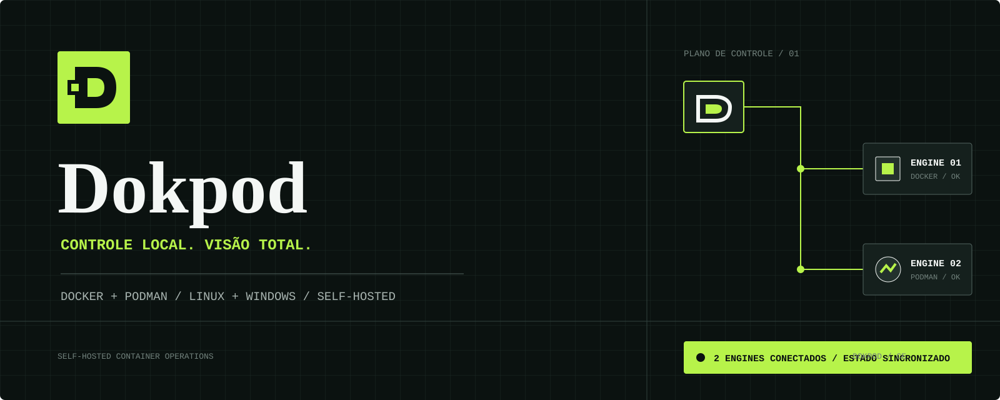
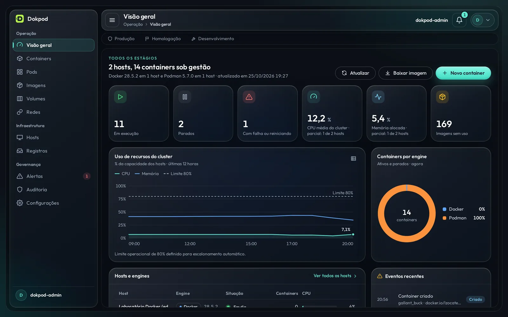
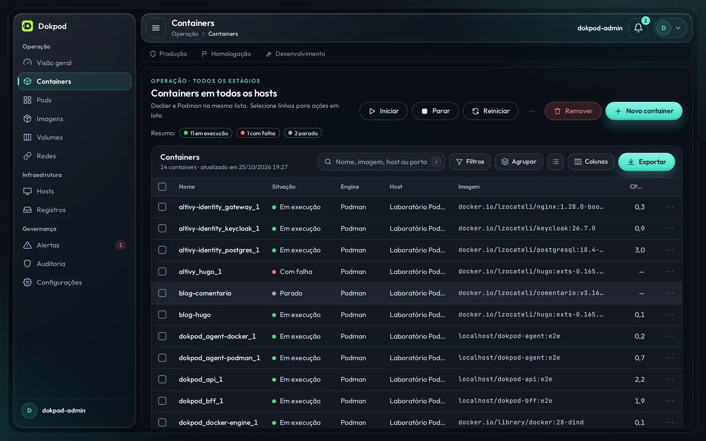
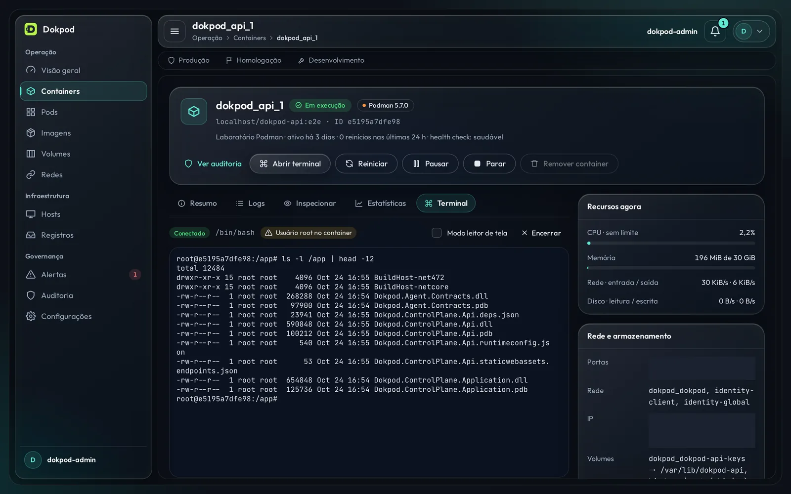
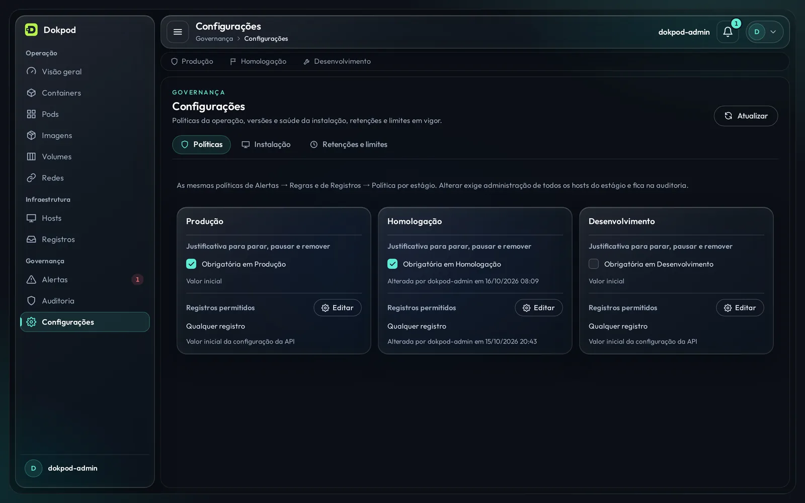
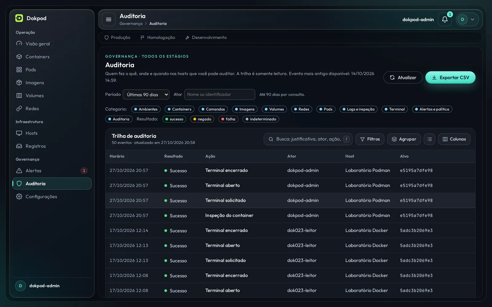
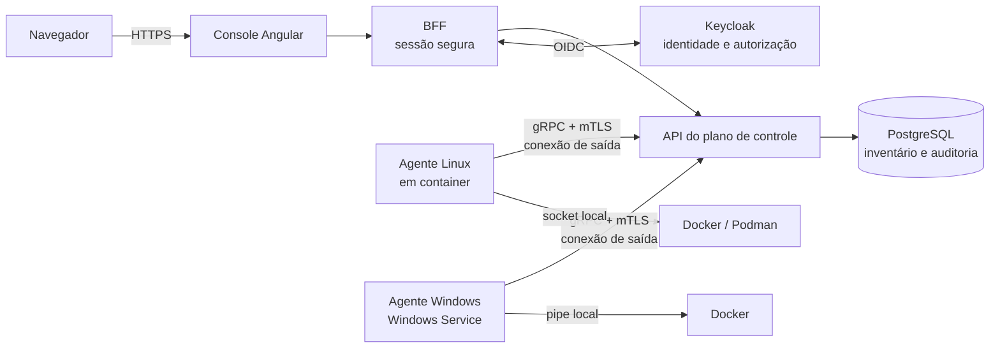

  

  
  
  
  

**Dokpod** é um console web self-hosted para descobrir, observar e operar containers **Docker** e **Podman** em vários servidores **Linux** e **Windows**, sem Kubernetes e sem nuvem do fornecedor. Um agente leve em cada servidor fala só com o engine local e abre uma conexão mTLS de saída com o plano de controle; nenhuma porta do Docker ou do Podman fica exposta na rede.

**Dokpod Community Edition** é gratuita e de código aberto, sob `AGPL-3.0-only`: sem chave de licença e sem limite artificial de servidores, usuários ou containers. Segurança, mTLS, autorização por ambiente e por ação e auditoria ficam sempre na Community Edition.

**A edição comercial do Dokpod** soma governança, automação e suporte, em três planos anuais cobrados por node com faixa de vCPU: **Teams** (US$ 900/ano), **Business** (US$ 1.500/ano) e **Enterprise** (sob medida). Ela ainda não está à venda; os planos estão em [`docs/licenciamento.md`](docs/licenciamento.md) e no [ADR 2026-0007](docs/adr/2026-0007-precificacao-por-node-e-faixa-de-vcpu.md) (`proposed`).

- [Conheça o Dokpod no site da Altivy](https://altivy.it/produtos/dokpod/)
- [Compare o Dokpod com outras plataformas de containers](https://altivy.it/produtos/dokpod/comparativo/)

## Por dentro do console

| Containers de todos os hosts, com ações em lote | Detalhe com terminal interativo auditado |
| --- | --- |
|  |  |
| **Políticas por estágio** | **Trilha de auditoria** |
|  |  |

Telas reais da stack de validação com Docker e Podman; endereços internos tarjados.

## O que o Dokpod faz

**Operação de containers**

- Iniciar, parar, pausar, reiniciar e remover, inclusive em lote, com justificativa obrigatória nas ações destrutivas onde o estágio exigir.
- Inspeção, logs ao vivo com segredos mascarados no agente e terminal interativo no navegador, com a sessão auditada.
- Criação guiada de containers e pull de imagens de registros permitidos.
- Volumes, redes e pods do Podman, com verificação de uso antes de qualquer remoção.
- Métricas de CPU e memória por host e por container, e eventos dos engines em tempo real.

**Governança e segurança**

- Permissões por ambiente e por ação, decididas pelo Keycloak a cada requisição; quem não tem permissão nem enxerga o ambiente.
- Login com LDAP, Active Directory ou OIDC pela federação do Keycloak; o Dokpod não guarda senhas.
- Políticas por estágio (Produção, Homologação, Desenvolvimento): justificativa obrigatória e registros de imagens permitidos.
- Alertas por consumo e estado, com silenciamento, e trilha de auditoria filtrável e exportável em CSV.
- Agente com identidade mTLS individual, revogação imediata e journal local; os containers seguem rodando se o plano de controle ou o agente cair, e o estado é reconciliado na volta.

## Como funciona

O plano de controle (console, BFF, API, PostgreSQL e Keycloak) roda em containers no seu ambiente. Em Linux, o agente roda em container; em Windows, como Windows Service self-contained, sem runtime .NET no host. O plano de controle nunca acessa o engine de um host remoto: só o agente fala com o engine local, por comandos de domínio versionados, nunca por um proxy genérico da API. Detalhes em [arquitetura](docs/arquitetura.md) e [segurança](docs/seguranca.md).

## Estado do projeto

O Dokpod está em **prévia**. O console está implementado e foi validado ponta a ponta na stack real com **Docker** e **Podman rootless** em Linux ([spec 023](specs/023-qualificacao-stack-real/spec.md)), inclusive com agente e servidor de versões consecutivas, usuário só de leitura e registro privado.

Ainda não há versão estável. Antes dela, continuam abertos: carga nominal com margem, assinatura e proveniência das imagens, o agente Windows em host limpo, o Podman rootful e a decisão humana de release. O veredito atual é **NO-GO**, mantido em [`docs/release-readiness.md`](docs/release-readiness.md).

| Alvo | Situação |
| --- | --- |
| Docker em Linux | validado na stack real; aguardando os gates de release |
| Podman rootless em Linux | validado na stack real; aguardando os gates de release |
| Docker em Windows (agente como Windows Service) | em qualificação |
| Podman rootful | não qualificado |
| Kubernetes, Swarm e Nomad | fora do escopo |

## Primeiros passos

Ainda não há pacote de instalação para produção. Para avaliar a prévia em laboratório:

1. Suba a plataforma de identidade e a stack local conforme [`deploy/e2e/README.md`](deploy/e2e/README.md), que traz Compose, certificados de laboratório e o agente opcional.
2. Siga a [distribuição e operação](docs/distribuicao.md) para engines homologados, agente Linux e Windows e ordem de atualização.
3. Configure realm, clients e permissões pelo guia de [configuração do Keycloak](docs/configuracao-keycloak.md).

Certificados, senhas e arquivos `.env` ficam sempre fora do repositório.

## Roteiro

Planejados para a edição comercial, como especificações Spec Kit aguardando revisão humana, em ordem:

1. [Aviso de nova versão das imagens em uso](specs/025-aviso-nova-versao-imagem/spec.md)
2. [Janelas de mudança por estágio](specs/026-janelas-de-mudanca/spec.md)
3. [Exportação de auditoria para SIEM, por syslog e OpenTelemetry](specs/027-exportacao-auditoria-siem/spec.md)
4. [Implantação somente por código em produção](specs/028-implantacao-somente-por-codigo/spec.md)
5. [Modelos de SSO prontos para Microsoft Entra ID, Google e GitHub](specs/029-modelos-sso/spec.md)

Também previstos: permissões por equipe e por recurso no console, detecção de divergência de políticas, stacks e Docker Compose, GitOps, operações agendadas e atualização coordenada de agentes ([licenciamento](docs/licenciamento.md#business)).

## Documentação

| Para | Leia |
| --- | --- |
| Entender escopo, princípios, stack e processo | [Visão geral técnica](docs/visao-geral-tecnica.md) |
| Arquitetura e fronteiras de segurança | [Arquitetura](docs/arquitetura.md), [Segurança](docs/seguranca.md) |
| Backend, agente, BFF e console | [Backend e agente](docs/backend.md), [BFF](docs/bff.md), [Frontend](docs/frontend.md) |
| Identidade e permissões | [Configuração do Keycloak](docs/configuracao-keycloak.md) |
| Instalar, operar e atualizar | [Distribuição](docs/distribuicao.md), [runbooks](docs/runbooks/) |
| Edições, preços e licença | [Licenciamento](docs/licenciamento.md), [ADRs](docs/adr/) |
| Prontidão de release | [Release readiness](docs/release-readiness.md) |
| Requisitos e roteiro | [Specs e rastreabilidade](specs/README.md) |

## Ajuda e suporte

A Community Edition tem suporte da comunidade: relate falhas e proponha melhorias nas [Issues](https://github.com/altivy-it/dokpod/issues). O suporte comercial, com SLA, chega com a edição comercial. Para conversar sobre a operação de containers da sua empresa, fale com a [Altivy](https://altivy.it/).

## Segurança

Não abra issue pública para vulnerabilidades. Use **Report a vulnerability** na aba **Security** do repositório, conforme a [política de segurança](.github/SECURITY.md).

## Contribuindo

Issues, relatos de falha e discussões são bem-vindos. Até a publicação de um acordo de contribuição (CLA), contribuições externas de código não são incorporadas, para preservar o licenciamento duplo. O desenvolvimento segue o processo Spec Kit descrito no [guia de contribuição](.github/CONTRIBUTING.md) e na [governança](.github/GOVERNANCE.md).

## Licença

O código da Community Edition é distribuído sob [`AGPL-3.0-only`](LICENSE). O nome, o logotipo e a identidade visual do Dokpod não estão cobertos pela licença do código.

Dokpod é um produto <a href="https://altivy.it/">Altivy</a>.

