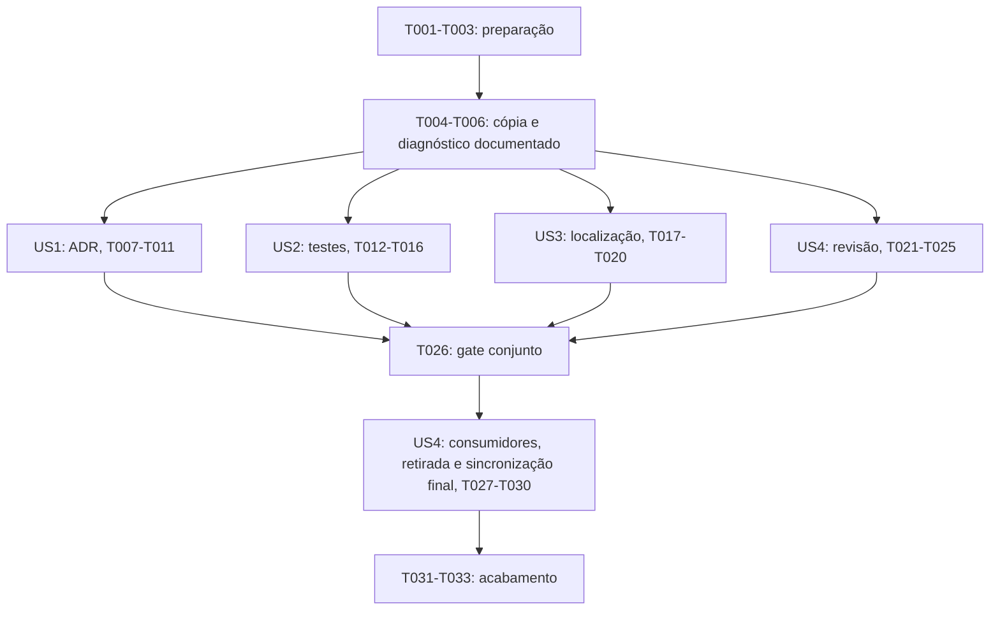

# Tarefas: Migração de Prompts Auxiliares para Skills

**Entrada**: Documentos de desenho em `specs/030-migrar-prompts-skills/`.
**Pré-requisitos**: [plan.md](plan.md), [spec.md](spec.md), [research.md](research.md), [data-model.md](data-model.md), [contrato](contracts/workflow-contract.md) e [quickstart.md](quickstart.md).
**Origem**: IA assistida, geração por `/speckit-tasks 025` em 2026-10-27.
**Estado**: implementação iniciada pela invocação humana de `/speckit-implement 025`, após reanálise sem achados pendentes; conclusão limitada às evidências registradas.
**Revisão desta geração**: correções documentais de I1 (sincronização da cópia) e I2 (diagnóstico antes da qualificação), identificados por `/speckit-analyze`; 33 IDs preservados, sujeitos a nova análise.
**Revisor humano**: Solicitante; identificação nominal e revisão pendentes.
**Autorização**: invocação humana explícita de `/speckit-implement 025` nesta conversa após a reanálise. O recorte T001-T033 mantém suas dependências e bloqueios; nenhuma tarefa ou checkbox autoriza ampliação de escopo, aceite de ADR, commit, push, publicação ou deploy. Identificação nominal do solicitante não informada.
**Renumeração posterior**: o solicitante autorizou explicitamente a mudança de 025 para 030, seguida de commit e push, em 2026-10-27. A invocação anterior e o caminho real da fixture permanecem como histórico; usar `specs/030-migrar-prompts-skills` para seleção ativa. Essa autorização de versionamento não libera T011 nem a remoção dos prompts.

**Testes**: exigidos por FR-015 e pelos cenários da spec. Preparar e executar os casos de contrato antes de converter o respectivo fluxo; registrar comportamento ausente ou baseline existente. Depois da implementação, repetir os casos no Session Target Copilot. Não provocar falha artificial numa revisão já existente nem executar produto apenas para testar customização.

**Organização**: preparação e fundação compartilhadas; uma fase por história, na prioridade da spec; fechamento transversal após a transição. O modelo é documental: não criar entidades de aplicação, APIs, schema ou migrations.

## Formato: `[ID] [P?] [Story] Descrição`

- Todas as tarefas começam com `- [ ] Tnnn`; tarefas das histórias incluem `[US1]` a `[US4]`.
- `[P]` significa arquivo de escrita distinto e ausência de dependência entre as tarefas da mesma onda; os pré-requisitos explícitos devem estar concluídos antes de iniciar a onda.
- Marcar conclusão somente após execução validada. Usar `PASS`, `FAIL`, `BLOCKED` ou `NOT RUN` nas evidências; nenhum dos três últimos libera a exclusão das fontes.

## Convenções de Caminhos

- Caminhos de repositório são relativos à raiz Dokpod; operações de filesystem devem resolvê-los e autorizá-los antes do acesso.
- `specs/030-migrar-prompts-skills/validation.md` será o único relatório novo de execução, criado após autorização; reúne baseline, matriz de paridade e evidências por fluxo. Não existe nem está preenchido nesta geração de tarefas.
- `/tmp/dokpod-025-validation/` é o alvo proposto de uma cópia descartável externa ao repositório para cenários com escrita. Validar o caminho, falhar se já existir e não sobrescrever nem remover conteúdo preexistente. Se indisponível, registrar bloqueio e obter outro caminho autorizado antes de continuar.
- Skills ficam em `.github/skills/`, agentes em `.github/agents/` e regras/modelos em seus donos atuais. Não criar scripts globais, dependências, agentes, plugins, MCP ou infraestrutura cloud.
- Evidências são sanitizadas e escritas de forma serial no relatório compartilhado; fixtures são sintéticas, sem secrets, sockets de engine, remotos de publicação ou execução de tarefas reais de produto.
- A cópia preparada em T004 não acompanha as edições do repositório automaticamente. T011/T016/T020/T025 sincronizam explicitamente seus candidatos conforme a seção 3 do quickstart; T030 sincroniza o estado final. Registrar lista de caminhos, hashes de origem/destino e sessão de carregamento em `validation.md`, sem sobrescrever arquivos da fixture que tenham divergido do estado previamente registrado.

## Fase 1: Preparação (Infraestrutura Compartilhada)

**Objetivo**: confirmar o recorte autorizado e registrar a referência anterior antes de modificar customizações.

- [X] T001 Conferir a referência à análise, a revisão humana e a autorização explícita das tarefas em `specs/030-migrar-prompts-skills/tasks.md`, registrando o recorte autorizado sem inventar identidade do revisor ou marcar aprovação; confirmar seleção explícita de `specs/030-migrar-prompts-skills` e interromper a execução se faltar qualquer pré-requisito.
- [X] T002 Criar `specs/030-migrar-prompts-skills/validation.md` após T001, registrando branch/referência anterior, estado inicial e hashes dos quatro prompts, skills oficiais, fontes/manifests de extensões, hooks e constituição; definir por fluxo os campos origem/destino, FR/SC, cenário, ambiente/versão/Session Target, agente/ferramentas, resultado esperado/obtido, evidência sanitizada e limitações, aceitando apenas `PASS`, `FAIL`, `BLOCKED` ou `NOT RUN` e sem declarar sucesso para observação não executada.
- [X] T003 Registrar em `specs/030-migrar-prompts-skills/validation.md`, após T002, a matriz completa de regras das quatro origens `.github/prompts/create-adr.prompt.md`, `.github/prompts/generate-tests.prompt.md`, `.github/prompts/localize-speckit.prompt.md` e `.github/prompts/review-change.prompt.md`, comparando também `.github/skills/pull-request-review/SKILL.md`; inventariar referências operacionais em guias/agentes e separar menções históricas, sem editar fontes ou componentes gerenciados.

## Fase 2: Fundação (Pré-requisitos Bloqueadores)

**Objetivo**: preparar a cópia e concluir o diagnóstico de ferramentas e critérios de contrato antes das histórias, sem exigir que os agentes já estejam corrigidos.

- [X] T004 Preparar o cenário isolado descrito em `specs/030-migrar-prompts-skills/quickstart.md` e documentar em `/tmp/dokpod-025-validation/README.md` a cópia descartável independente, imagens já disponíveis, runner containerizado e limites de escrita; registrar os caminhos copiados e hashes iniciais para futuras sincronizações, impedir colisão de destino, cópia de secrets e descoberta simultânea da cópia e do original, sem instalar dependências ou executar workflows reais.
- [X] T005 Registrar em `specs/030-migrar-prompts-skills/validation.md`, após T004, o diagnóstico inicial de uma sessão nova do Copilot e dos agentes definidos em `.github/agents/solution-architect.agent.md`, `.github/agents/quality-engineer.agent.md` e `.github/agents/code-reviewer.agent.md`; observar os aliases atuais `read`, `search`, `edit`, `web`, `execute`, `todo` e delegação efetiva, distinguindo capacidades comprovadas, incompatibilidades e observações não executadas; encaminhar adaptações comprovadas a T009/T014/T023, sem omitir `tools`, usar curinga ou adicionar execução ao revisor. Concluir o registro do diagnóstico não exige aliases já corrigidos nem declara a qualificação aprovada.
- [X] T006 Registrar em `specs/030-migrar-prompts-skills/validation.md`, após T005, os critérios comuns C1/C6 e a disponibilidade de parser existente em container: `name` igual ao diretório, no máximo 64 caracteres minúsculos alfanuméricos/hífens, `description` pt-BR com no máximo 1024 caracteres, `argument-hint`, `user-invocable: true`, `disable-model-invocation: true` nas três novas skills, ausência de seleção `agent`/`model`/`tools` herdada e política de ativação da revisão inalterada; identificar cada pendência e a validação que ela bloqueia, mantendo `BLOCKED` ou `NOT RUN` nessa validação, sem impedir as edições documentais autorizadas para adaptar aliases. Não instalar parser, alegar parsing por regex ou executar o fluxo afetado antes de conferir as ferramentas após a adaptação.

**Checkpoint**: T001 a T006 concluídas como preparação e diagnóstico documentado antes de iniciar uma história. Pendências de qualificação não precisam estar resolvidas para preparar casos e realizar edições estáticas autorizadas em T008/T009/T013/T014/T018/T022/T023. Ausência de ferramenta impede a operação que depende dela, não a correção documental por ferramenta de edição autorizada já disponível. T010/T015/T019/T024 continuam bloqueadas se não puderem realizar as verificações exigidas; T011/T016/T020/T025 só executam cenários depois da paridade estática, sincronização e comprovação das ferramentas do fluxo corrigido. Nenhuma pendência libera T026 ou a retirada das fontes.

## Fase 3: História de Usuário 1 - Apoiar decisões arquiteturais no Copilot (Prioridade: P1) MVP

**Objetivo**: entregar o fluxo de ADR no Copilot com autorização, justificativa e status `proposed` preservados.

**Teste independente**: V01/V02 e parcela ADR de V10, em cópia descartável, com seleção explícita do Architect; decisão autorizada produz somente ADR proposto e pedidos sem autorização/justificativa ou de aceite automático não geram efeito proibido.

### Testes da História de Usuário 1

- [X] T007 [US1] Preparar e registrar em `specs/030-migrar-prompts-skills/validation.md` as entradas e expectativas V01/V02 e ADR de V10 conforme `specs/030-migrar-prompts-skills/quickstart.md`, antes da conversão; usar planejamento sintético e autorização da fixture identificada, confirmar que o destino ainda não é invocável e cobrir também decisão não duradoura, falta de justificativa e pedido de implementação de código, sem alterar ADR ou spec reais.

### Implementação da História de Usuário 1

- [X] T008 [P] [US1] Criar `.github/skills/dokpod-create-adr/SKILL.md` após T007, preservando integralmente a origem e C1/C2: metadados e limites conferidos em T006, planejamento/decisão/autorização/revisor obrigatórios, até três opções, recomendação falsificável, modelo e sequência anual, origem IA assistida, revisão pendente e `proposed`, sem código ou aceite; recalcular links ao modelo, regras e agente sem duplicá-los.
- [X] T009 [P] [US1] Ajustar a referência de uso em `.github/agents/solution-architect.agent.md` após T007 para orientar `/dokpod-create-adr` no agente explicitamente selecionado; preservar papel, restrições e ferramentas, adaptando apenas aliases cuja incompatibilidade tenha sido demonstrada em T005 para capacidade equivalente, sem afirmar sandbox por diretório ou ampliar autorização de escrita.
- [X] T010 [US1] Validar `.github/skills/dokpod-create-adr/SKILL.md` e `.github/agents/solution-architect.agent.md` após T008/T009 por parser existente em container, links e matriz de paridade; registrar em `specs/030-migrar-prompts-skills/validation.md` todas as regras C1/C2 e confirmar ausência de mudança em modelos, instruções e ADRs reais.
- [x] T011 [US1] Sincronizar `.github/skills/dokpod-create-adr/SKILL.md` e `.github/agents/solution-architect.agent.md` do repositório para os caminhos correspondentes na cópia descartável após T010, conforme a seção 3 de `specs/030-migrar-prompts-skills/quickstart.md`, bloqueando conflitos e comprovando hashes iguais; abrir sessão nova do Copilot e conferir as ferramentas do Architect após eventual adaptação de T009 antes de executar V01/V02 e ADR de V10. Registrar em `specs/030-migrar-prompts-skills/validation.md` sincronização, descoberta, seleção, ferramentas, diff/hashes e respostas, até três alternativas, rastreabilidade e nenhum aceite/código/escrita sem autorização; sem ferramenta necessária, não executar cenários nem tratar recusa textual como restrição técnica.

**Checkpoint**: US1 utilizável independentemente e sem remover qualquer prompt. T011 com evidência suficiente habilita apenas a demonstração do MVP, não a transição completa.

## Fase 4: História de Usuário 2 - Produzir evidências de teste autorizadas (Prioridade: P1)

**Objetivo**: entregar o fluxo de testes limitado à tarefa/remediação autorizada, com infraestrutura e evidências confiáveis.

**Teste independente**: V03/V04 e parcela testes de V10, usando fixture mínima e runner em container; o cenário autorizado demonstra teste discriminante e o pedido sem autorização não escreve nem executa testes.

### Testes da História de Usuário 2

- [X] T012 [US2] Preparar as entradas de V03/V04 e testes de V10 antes da conversão e registrá-las em `specs/030-migrar-prompts-skills/validation.md`, a partir de `specs/030-migrar-prompts-skills/quickstart.md`; delimitar no README descartável de T004 o artefato/tarefa sintéticos, autorização humana da fixture, teste inicialmente falho e sucesso esperado no runner containerizado, sem usar backend/frontend reais para testar a skill.

### Implementação da História de Usuário 2

- [X] T013 [P] [US2] Criar `.github/skills/dokpod-generate-tests/SKILL.md` após T012 com C1/C3 e os metadados/limites de T006, preservando tarefa via `/speckit-implement` ou remediação via `/speckit-bug-fix`, matriz risco-teste, teste discriminante, erros/bordas, suíte relacionada e devolução de evidências; referenciar regras vigentes de containers, nginx, engines/PostgreSQL reais, exceção Windows e N/N-1 quando aplicáveis, sem criar requisito do diff ou corrigir produto fora do escopo.
- [X] T014 [P] [US2] Ajustar a referência de uso em `.github/agents/quality-engineer.agent.md` após T012 para orientar `/dokpod-generate-tests` mediante seleção explícita; manter escopo autorizado, matriz de plataformas e restrições, adaptando somente aliases comprovadamente incompatíveis em T005 sem ampliar ferramentas, delegação ou execução no host.
- [X] T015 [US2] Validar `.github/skills/dokpod-generate-tests/SKILL.md` e `.github/agents/quality-engineer.agent.md` após T013/T014, conferindo C1/C3, paridade, YAML, links e campos de saída; registrar em `specs/030-migrar-prompts-skills/validation.md` a distinção entre infraestrutura realmente usada na fixture e plataformas apenas citadas como regras, sem qualificar engine ou Windows por inspeção textual.
- [x] T016 [US2] Sincronizar `.github/skills/dokpod-generate-tests/SKILL.md` e `.github/agents/quality-engineer.agent.md` para a cópia descartável após T015, conforme a seção 3 de `specs/030-migrar-prompts-skills/quickstart.md`, bloqueando conflitos e comprovando hashes iguais; abrir sessão nova do Copilot e conferir ferramentas do Quality após eventual adaptação de T014 e runner containerizado antes de executar V03/V04 e testes de V10. Registrar em `specs/030-migrar-prompts-skills/validation.md` sincronização, teste discriminante inicialmente falho e depois bem-sucedido, suíte, autorização e ausência de escrita/execução no negativo; falta de ferramenta ou infraestrutura mantém bloqueio ou `NOT RUN`, sem fallback para host nem execução de tarefa real.

**Checkpoint**: US2 qualificada independentemente de US1, preservando os prompts e as regras de infraestrutura. A fixture não constitui certificação de Docker, Podman, PostgreSQL ou Windows.

## Fase 5: História de Usuário 3 - Auditar e localizar o Spec Kit com segurança (Prioridade: P2)

**Objetivo**: disponibilizar auditoria e tradução explícita sem instalar, regenerar ou alterar componentes gerenciados como efeito da conversão.

**Teste independente**: V05/V06/V07 e parcela localização de V10, em alvos sintéticos, com hashes, fonte/materialização diferentes e exclusões; ausência de modo/alvo não produz tradução.

### Testes da História de Usuário 3

- [X] T017 [US3] Preparar os casos V05/V06/V07 e localização de V10 antes da conversão e registrá-los em `specs/030-migrar-prompts-skills/validation.md`, usando apenas a cópia descartável de T004; incluir prosa traduzível, contratos técnicos, exemplos JSON/YAML, títulos consumidos, exclusões, alterações locais e fonte/materialização diferentes, com hashes anteriores e expectativa de não sobrescrita ou instalação.

### Implementação da História de Usuário 3

- [X] T018 [US3] Criar `.github/skills/dokpod-localize-speckit/SKILL.md` após T017 com C1/C4 e os metadados/limites de T006, preservando integralmente o procedimento, todos os placeholders/estados, exclusões e verificações da origem; manter parâmetros como linguagem natural, auditoria sem modo e inventário sem alvo, comparação de equivalência e proibições de instalar/reconciliar/ocultar hashes, sem inventar idioma ou hook e recalculando links à constituição e às regras.
- [X] T019 [US3] Validar `.github/skills/dokpod-localize-speckit/SKILL.md` após T018 por parser existente, links, paridade completa e contagem dos tokens técnicos da origem, explicitando substituições permitidas de prosa e diferenças intencionais de metadados; registrar em `specs/030-migrar-prompts-skills/validation.md` qualquer limite sem ignorar blocos inteiros ou executar workflows para validar texto.
- [x] T020 [US3] Sincronizar `.github/skills/dokpod-localize-speckit/SKILL.md` para a cópia descartável após T019, conforme a seção 3 de `specs/030-migrar-prompts-skills/quickstart.md`, bloqueando conflitos e comprovando hashes iguais; abrir sessão nova do Copilot e conferir as ferramentas do agente padrão antes de executar V05/V06/V07 e localização de V10. Registrar em `specs/030-migrar-prompts-skills/validation.md` sincronização, prosa traduzida apenas no alvo sintético autorizado, auditoria/inventário sem escrita, equivalência sem cópia cega e integridade de tokens/estrutura/exclusões; ferramenta ausente bloqueia o cenário dependente, sem usar componentes reais como alvo de teste.

**Checkpoint**: US3 qualificada independentemente; nenhuma tradução real de componente gerenciado foi autorizada pela migração. Sem parser ou comprovação de integridade, o gate correspondente permanece pendente.

## Fase 6: História de Usuário 4 - Revisar mudanças e concluir a transição (Prioridade: P2)

**Objetivo**: consolidar revisão somente leitura, atualizar consumidores e retirar as quatro fontes apenas após a qualificação conjunta.

**Teste independente**: V08/V09 sobre diff fornecido em fixture e inspeção das ferramentas do Reviewer, sem terminal; o subfluxo de revisão é independente, mas a retirada conjunta depende da conclusão validada de US1/US2/US3.

### Testes da História de Usuário 4

- [X] T021 [US4] Preparar V08/V09 e registrar em `specs/030-migrar-prompts-skills/validation.md` o baseline de `.github/skills/pull-request-review/SKILL.md` e as diferenças exclusivas de `.github/prompts/review-change.prompt.md` antes de consolidar; usar diff sintético fornecido, base/head e cenário sem rastreabilidade, cobrindo achados completos, ausência explícita de achados e recusa de escrita/comando inofensivo, sem executar comando destrutivo nem forçar uma falha artificial no fluxo existente.

### Implementação da História de Usuário 4

- [X] T022 [P] [US4] Consolidar somente diferenças necessárias em `.github/skills/pull-request-review/SKILL.md` após T021, preservando C1/C5, nome, ativação, dimensões adicionais, base/head, rastreabilidade e saída por severidade com localização/cenário/impacto/correção/teste; orientar seleção do Code Reviewer, manter proibição de todos os comandos e mutações e não criar outra skill equivalente.
- [X] T023 [P] [US4] Ajustar a referência de uso em `.github/agents/code-reviewer.agent.md` após T021 para a skill canônica, mantendo apenas capacidades de leitura/busca e ausência de delegação que contorne restrições; adaptar somente aliases comprovados incompatíveis em T005, sem terminal, execução, escrita, integração mutante, curinga ou remoção da lista de ferramentas.
- [X] T024 [US4] Validar `.github/skills/pull-request-review/SKILL.md` e `.github/agents/code-reviewer.agent.md` após T022/T023 por YAML, links e matriz de paridade C1/C5, registrando em `specs/030-migrar-prompts-skills/validation.md` que regras adicionais da skill foram preservadas e a seleção de agente não é herdada da invocação.
- [x] T025 [US4] Sincronizar `.github/skills/pull-request-review/SKILL.md` e `.github/agents/code-reviewer.agent.md` para a cópia descartável após T024, conforme a seção 3 de `specs/030-migrar-prompts-skills/quickstart.md`, bloqueando conflitos e comprovando hashes iguais; abrir sessão nova do Copilot e comprovar ferramentas do Reviewer após eventual adaptação de T023, somente leitura/busca e sem mutação/delegação de contorno, antes de executar V08/V09. Registrar em `specs/030-migrar-prompts-skills/validation.md` sincronização, seleção, ferramentas, achados/ausência, rastreabilidade e recusa sem escrita/comandos; ferramenta ausente ou restrição não comprovada bloqueia a qualificação, sem adicionar shell para obter contexto.
- [x] T026 [US4] Conferir em `specs/030-migrar-prompts-skills/validation.md`, após T011/T016/T020/T025, os quatro fluxos, 100% das regras da matriz, V01 a V10 e integridade dos componentes protegidos; registrar o resultado do gate conjunto e bloquear T027 a T030 se houver `FAIL`, `BLOCKED`, `NOT RUN`, colisão de nomes ou evidência insuficiente em qualquer critério necessário.
- [x] T027 [US4] Atualizar `.github/ENGENHARIA_ASSISTIDA.md` (antigo `.github/README.md`, renomeado em 2026-10-28 para o GitHub exibir o README da raiz) e `.github/COPILOT_GUIDE.md` após T026 com os quatro comandos canônicos, seleção explícita dos especialistas, skills manuais e revisão única; substituir orientações de uso dos prompts por referências aos destinos existentes, sem alterar processo Spec Kit, autoridade, aprovações ou descrever como verificado um alvo não executado.
- [x] T028 [US4] Atualizar `.github/copilot-instructions.md` e `.github/GOVERNANCE.md` após T027, substituindo referências operacionais à localização e aos prompts antigos pelas skills e descrevendo o uso no Copilot sem enfraquecer regras globais; conferir todas as referências inventariadas em T003 e ajustar apenas referências operacionais comprovadas no escopo, preservando menções históricas e encaminhando expansão necessária ao responsável.
- [x] T029 [US4] Excluir `.github/prompts/create-adr.prompt.md`, `.github/prompts/generate-tests.prompt.md`, `.github/prompts/localize-speckit.prompt.md` e `.github/prompts/review-change.prompt.md` somente após T026/T027/T028 validadas, conferindo antes que as fontes não ganharam alterações locais desde o baseline; não manter pontes Local, não remover arquivos adicionais e registrar a retirada em `specs/030-migrar-prompts-skills/validation.md`.
- [x] T030 [US4] Sincronizar o estado final após T029 para a cópia descartável conforme a seção 3 do quickstart, incluindo as quatro skills canônicas, os três agentes e `.github/ENGENHARIA_ASSISTIDA.md` (antigo `.github/README.md`), `.github/COPILOT_GUIDE.md`, `.github/copilot-instructions.md` e `.github/GOVERNANCE.md`; remover da cópia somente os quatro prompts já excluídos no repositório, após conferir os hashes anteriores registrados e sem apagar arquivos da fixture. Conferir igualdade dos candidatos, ausência dos prompts e referências operacionais quebradas, abrir sessão nova do Copilot e verificar descoberta e início dos quatro fluxos sem escrita real; registrar em `specs/030-migrar-prompts-skills/validation.md` resultado ou recuperação limitada ao diff da migração mediante revisão, sem sobrescrever trabalho do usuário.

**Checkpoint**: a revisão pode ser entregue antes das outras histórias, mas T026 a T030 não. Retirada e ausência de referências operacionais quebradas precisam de evidência; não marcar US4 como concluída apenas porque a consolidação da revisão passou.

## Fase 7: Acabamento e Aspectos Transversais

**Objetivo**: consolidar evidências e comprovar que a manutenção permaneceu dentro do recorte autorizado.

- [x] T031 Comparar o baseline de T002 com o estado final e registrar em `specs/030-migrar-prompts-skills/validation.md`, após T030, hashes e diff de escopo de skills oficiais, extensões/manifests, hooks, constituição e histórico, confirmando ausência de alterações indevidas no produto, contratos, deployment, secrets e trabalho preexistente; conferir UTF-8, Markdown, frontmatter e links dos arquivos alterados com ferramentas existentes em containers e declarar limitações, sem instalar dependências.
- [x] T032 Consolidar `specs/030-migrar-prompts-skills/validation.md` após T031, vinculando cada regra/FR/SC às evidências dos quatro fluxos e dez cenários, com versão/harness/agente/ferramentas, resultados, plataformas e riscos residuais; manter `NOT RUN` explícito, não alegar qualificação cloud/CLI/engines/Windows nem aceite de ADR e registrar que não houve commit, push, publicação ou deploy como efeito da migração.
- [x] T033 Conferir `specs/030-migrar-prompts-skills/tasks.md` após T032, mantendo checkboxes coerentes com execução validada, vínculos ao relatório e registro da autorização humana original, sem alterar aprovação ou status histórico; comunicar qualquer residual para `/speckit-converge` sem criar ou executar tarefas novas automaticamente.

## Dependências e Ordem de Execução

### Dependências entre Fases

- Preparação: T001 -> T002 -> T003. A análise e autorização humanas são precondições para começar T001, não resultados que a IA pode conceder.
- Fundação: T004 -> T005 -> T006, após T003; concluir preparação e registro do diagnóstico antes das histórias, mesmo havendo pendências de qualificação. A pendência bloqueia a operação dependente, não a edição estática autorizada que pode corrigi-la.
- US1: T007 -> (T008 e T009) -> T010 -> T011; T011 sincroniza candidatos e valida ferramentas após adaptação antes dos cenários.
- US2: T012 -> (T013 e T014) -> T015 -> T016; T016 sincroniza candidatos e valida ferramentas/runner antes dos cenários.
- US3: T017 -> T018 -> T019 -> T020; T020 sincroniza o candidato e valida ferramentas antes dos cenários.
- Revisão de US4: T021 -> (T022 e T023) -> T024 -> T025; T025 sincroniza candidatos e comprova ferramentas restritas após adaptação antes dos cenários.
- Transição de US4: T011, T016, T020 e T025 -> T026 -> T027 -> T028 -> T029 -> T030.
- Acabamento: T030 -> T031 -> T032 -> T033.

### Grafo das Histórias

### Dependências entre Histórias

US1 e US2 são P1; US3 e US4 são P2. Na execução serial, seguir essa ordem. As três primeiras histórias e a parte de revisão da quarta não dependem funcionalmente entre si, somente da preparação e do diagnóstico documentado na fundação. A qualificação funcional de cada uma exige seus candidatos sincronizados e as ferramentas necessárias conferidas depois dos ajustes. A transição final pertence a US4 e exige as quatro qualificações. Nenhuma história exige modelos, serviços ou endpoints de produto.

### Dentro de Cada História

Preparar casos e registrar o baseline antes de implementar o comportamento. Quando o destino ainda não existir, registrar o teste de descoberta não satisfeito; quando o fluxo já existir, registrar a cobertura atual e somente lacunas reais. Validar primeiro o recorte recém-editado; se falhar, reparar o mesmo recorte antes de ampliar. Qualificação funcional não pode ser substituída por inspeção de Markdown, parser ou hash.

Concluir o diagnóstico de T005/T006 significa registrar evidências e pendências, não declarar ferramentas aprovadas. Incompatibilidade de alias comprovada pode ser corrigida em T009/T014/T023 sem esperar o agente afetado funcionar; a edição é feita por capacidade de edição já autorizada, sem invocar operações do fluxo incompatível. Depois da paridade estática, sincronizar a lista autorizada, comparar hashes e abrir uma sessão nova antes de conferir ferramentas e executar cenários. Sessão inacessível, ferramenta ausente ou lista de ferramentas não comprovada mantém a qualificação e T026 bloqueadas.

### Oportunidades de Paralelismo

Existem seis tarefas marcadas `[P]`, organizadas em três pares: T008/T009, T013/T014 e T022/T023. Cada par começa somente depois do respectivo caso preparado e da fundação, e escreve arquivos diferentes. Não há paralelismo interno necessário para US3.

Após a fundação, histórias independentes também podem avançar por frentes distintas se a equipe autorizar, mas toda atualização de `validation.md` e de checkboxes é serializada pelo responsável. Não editar simultaneamente guias globais, agentes de outro fluxo, relatório ou o mesmo workspace de fixture. Paralelismo documental não autoriza subagentes a implementar sem escopo e autorização.

## Exemplos de Paralelismo por História

### US1: após T007

Executar T008 no arquivo `.github/skills/dokpod-create-adr/SKILL.md` em paralelo com T009 no arquivo `.github/agents/solution-architect.agent.md`; depois integrar e validar ambos em T010. Evidências compartilhadas só são gravadas após concluir a onda.

### US2: após T012

Executar T013 no arquivo `.github/skills/dokpod-generate-tests/SKILL.md` em paralelo com T014 no arquivo `.github/agents/quality-engineer.agent.md`; T015 depende de ambas e T016 depende da validação estática.

### US3: sem paralelismo interno

Executar T017 a T020 serialmente. Após seus pré-requisitos, a edição de `.github/skills/dokpod-localize-speckit/SKILL.md` em T018 pode coexistir com a edição de outra história em arquivo distinto, mas testes/relatório aguardam a coordenação das fixtures e não escrevem em `validation.md` em paralelo.

### US4: revisão independente, retirada serial

Executar T022 em `.github/skills/pull-request-review/SKILL.md` em paralelo com T023 em `.github/agents/code-reviewer.agent.md` após T021. T026 a T030 são serializadas e aguardam todas as histórias; não paralelizar exclusão com atualização de referências ou comprovação de integridade.

## Estratégia de Implementação

### MVP Primeiro (Somente História de Usuário 1)

1. Obter análise, revisão e autorização do recorte.
2. Concluir T001 a T006 e US1, T007 a T011.
3. Demonstrar ADR autorizado e recusas esperadas no Copilot, com evidência independente.
4. Parar para revisão do incremento; manter os quatro prompts, sem declarar a migração completa ou iniciar retirada.

### Entrega Incremental

1. Acrescentar e qualificar US2, preservando o MVP.
2. Acrescentar e qualificar US3, sem traduzir componentes reais.
3. Consolidar a revisão de US4 e validar suas restrições.
4. Liberar T026 apenas com as quatro qualificações e matriz completa; depois atualizar consumidores, retirar fontes, verificar a sessão nova e concluir acabamento.
5. Se um gate falhar ou não puder ser executado, registrar o bloqueio e preservar fontes; não concluir por inferência nem flexibilizar ferramenta, infraestrutura ou aprovação.

### Rastreabilidade para Análise

| Requisitos | Tarefas principais |
| --- | --- |
| FR-001, FR-003, FR-012; SC-001 | T006, T008-T011, T013-T016, T018-T020, T022-T025, T030 |
| FR-002; SC-002 | T003, T010, T015, T019, T024, T026 |
| FR-004 | T007-T011 |
| FR-005, FR-006 | T012-T016 |
| FR-007, FR-008 | T017-T020 |
| FR-009, FR-010 | T021-T025 |
| FR-011; SC-003 | T005, T009, T011, T014, T016, T020, T023, T025 |
| FR-013; SC-004 | T026-T030 |
| FR-014, FR-016; SC-005 | T001-T004, T029, T031-T033 |
| FR-015; SC-006 | T002, T007, T011, T012, T016, T017, T020, T021, T025, T026, T032 |

### Resumo do Recorte

33 tarefas: preparação 3, fundação 3, US1 5, US2 5, US3 4, US4 10 e acabamento 3. As tarefas de US4 incluem a transição conjunta, não uma dependência artificial para testar sua revisão. Há três pares de paralelismo explícito e dez cenários de validação definidos no quickstart, com V10 aplicado às três skills manuais. As correções I1/I2 estão incorporadas em T004-T006, T011/T016/T020/T025 e T030, sem criar IDs ou antecipar execução; a nova análise deve verificar sua consistência.

## Observações

T001 a T010 foram concluídas no escopo registrado em [validation.md](validation.md). A skill de ADR foi criada e validada estaticamente; nenhum prompt foi excluído. T011 permanece bloqueada na qualificação funcional em sessão nova do Copilot, apesar da sincronização dos candidatos ter passado; a execução serial parou antes de T012. A existência da skill, sua validação estrutural ou o check de pré-requisitos não equivalem à qualificação do harness. Para retomar, fornecer a evidência funcional exigida em T011 sem dispensar o gate de retirada.

**Conclusão (2026-10-29)**: T011, T016, T020, T025 e T026 a T033 concluídas por decisão explícita do solicitante, que aceitou a própria declaração de validação no Copilot como evidência ([validation.md](validation.md#decisão-do-solicitante-e-gate-conjunto-t026-2026-10-29)). Residual: cenários sem respostas registradas.
