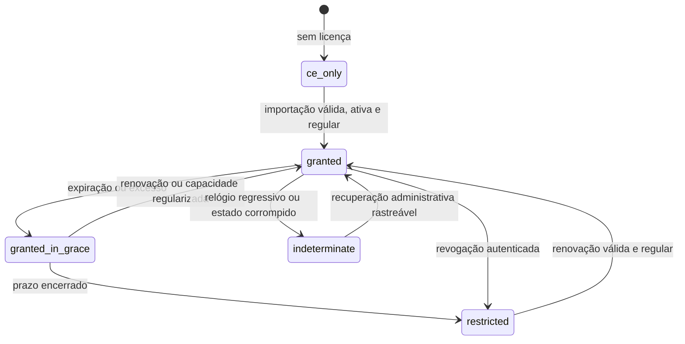

# Modelo de Dados: Licenciamento Business offline

**Feature**: [spec.md](spec.md) | **Pesquisa**: [research.md](research.md)

Todas as tabelas ficam no schema `dokpod` do PostgreSQL existente (D-007), criadas por migrations SQL expand-contract. Só a composição Business grava nelas (D-009).

## Licença (documento assinado, não tabela)

Payload do JWS ([contracts/license-format.md](contracts/license-format.md)):

| Campo | Tipo | Regra |
| --- | --- | --- |
| `schemaVersion` | int | suportado: `1` |
| `meteringVersion` | int | suportado: `1` (fórmula de D-005) |
| `licenseId`, `organizationId` | string ≤ 128 | IDs opacos do emissor |
| `revision` | int ≥ 1 | estritamente crescente por `licenseId` |
| `product` | string | exatamente `dokpod-business` |
| `plan` | string ≤ 64 | rótulo comercial; não concede direitos |
| `issuedAt`, `notBefore`, `expiresAt` | instante UTC | `issuedAt ≤ notBefore < expiresAt` |
| `capacity` | objeto | `{ "mode": "limited", "nodeEquivalents": n > 0 }` ou `{ "mode": "unlimited" }` |
| `vcpuBand` | int > 0 | vCPUs por node equivalente |
| `windowDays` | int | `30` |
| `graceDays` | int | `30` |
| `slots` | lista 1..2 | `{ "slotId", "kind": "production"\|"staging", "enabled": bool, "nodeEquivalents": n ≥ 0 }`; soma das cotas habilitadas ≤ capacidade; slot desabilitado não usa cota |
| `capabilities` | lista ≤ 64 | allowlist de direitos conhecidos pela versão |

## license_revisions

Cada arquivo recebido (licença ou pacote de revogação), aceito ou recusado.

| Coluna | Tipo | Regra |
| --- | --- | --- |
| `revision_id` | uuid | PK |
| `document_type` | text | `license` ou `revocation` |
| `received_at_utc` | timestamptz | |
| `received_by` | text | sujeito do Keycloak |
| `content_sha256` | bytea(32) | hash dos bytes recebidos |
| `content` | bytea | bytes originais, ≤ 64 KiB (reverificados ao uso, FR-010) |
| `license_id`, `revision` | text, int | preenchidos após verificação |
| `outcome` | text | `accepted`, `rejected` |
| `failure_code` | text null | `license_invalid`, `license_obsolete`… |

Índice único em `(license_id, revision)` para documentos aceitos.

## licensing_state

Linha única por instalação; controle otimista por `version`.

| Coluna | Tipo | Regra |
| --- | --- | --- |
| `installation_slot_id` | text | slot escolhido na importação |
| `active_revision_id` | uuid null | FK para a última licença íntegra |
| `revocation_sequence` | bigint | maior sequência importada |
| `expiry_grace_until_utc` | timestamptz null | `expiresAt + graceDays` |
| `excess_started_at_utc`, `excess_grace_until_utc` | timestamptz null | gravados na primeira detecção; não recomeçam |
| `last_trusted_instant_utc` | timestamptz | maior instante confiável observado |
| `version` | bigint | concorrência otimista (`If-Match`) |

### Estados derivados

```text
authenticity: absent | valid | invalid | revoked
validity:     not_started | active | expired_in_grace | expired
metering:     regular | excess_in_grace | excess | unknown
entitlement:  ce_only | granted | granted_in_grace | restricted | indeterminate
```

`entitlement` = `granted` só com `authenticity=valid`, `validity=active` e `metering=regular`. Com tolerância ativa (expiração ou excesso): `granted_in_grace`. Com prazo encerrado ou revogação: `restricted`. Com relógio abaixo de `last_trusted_instant_utc`, estado corrompido ou medição desconhecida que impeça a decisão: `indeterminate`. Os prazos não se somam: vale o menor entre os ativos.

## licensing_hosts e licensing_host_environments

| Tabela | Colunas | Regra |
| --- | --- | --- |
| `licensing_hosts` | `host_id` uuid PK, `label` text, `created_at_utc`, `removed_at_utc` null | ID opaco local; remoção fecha a participação futura |
| `licensing_host_environments` | `host_id`, `environment_id`, `linked_at_utc`, `unlinked_at_utc` null | um ambiente pertence a no máximo um host ativo |

Toda criação, associação, desassociação e remoção gera evento de licenciamento.

## licensing_capacity_observations (particionada por mês)

| Coluna | Tipo | Regra |
| --- | --- | --- |
| `host_id` | uuid | |
| `observed_at_utc` | timestamptz | chave de partição |
| `vcpus` | int null | null quando desconhecido |
| `source` | text | `engine`, `process_fallback`, `unknown` |
| `environment_id` | uuid | ambiente que reportou |

Gravada só quando a capacidade confiável do host muda ou na conexão do agente. Retenção ≥ 35 dias mais a âncora mais recente de cada host anterior à janela (D-005).

## licensing_events (particionada por mês, append-only)

| Coluna | Tipo |
| --- | --- |
| `event_id` | uuid |
| `occurred_at_utc` | timestamptz (partição) |
| `actor_id` | text null (sujeito, ou null para o sistema) |
| `correlation_id` | uuid |
| `action` | text: `license.imported`, `license.rejected`, `license.state_changed`, `license.grace_started`, `license.grace_ended`, `license.expiry_warning` (60, 30 e 7 dias, FR-032), `license.report_exported` (FR-033), `revocation.imported`, `host.linked`, `host.unlinked`, `host.removed` |
| `details` | jsonb com allowlist por ação (IDs, revisões, códigos, sem conteúdo da licença) |

## Transições



Em nenhum estado há efeito sobre workloads, dados, leitura, backup, exportação, renovação ou recursos da CE (FR-003).
